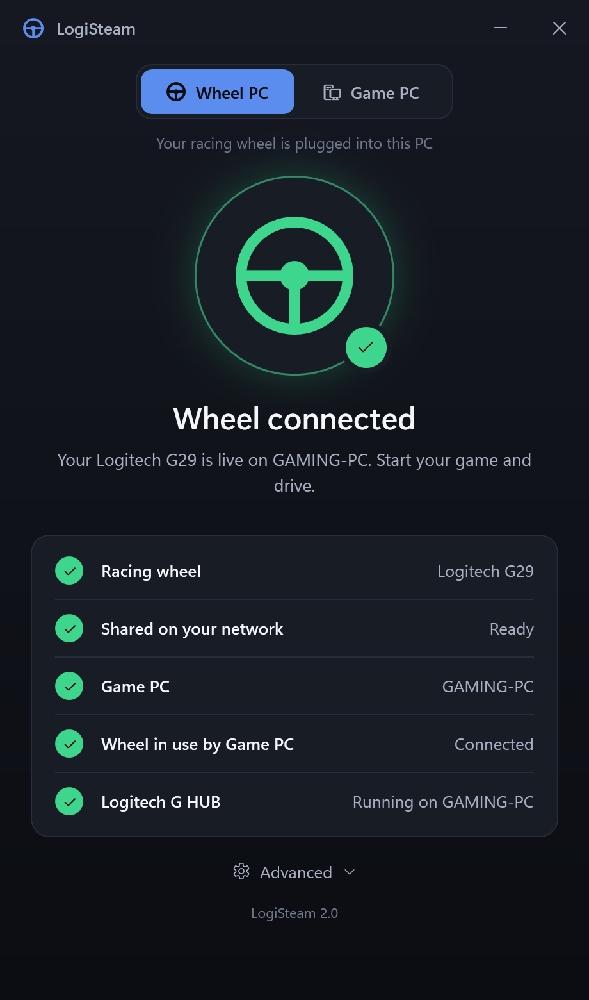
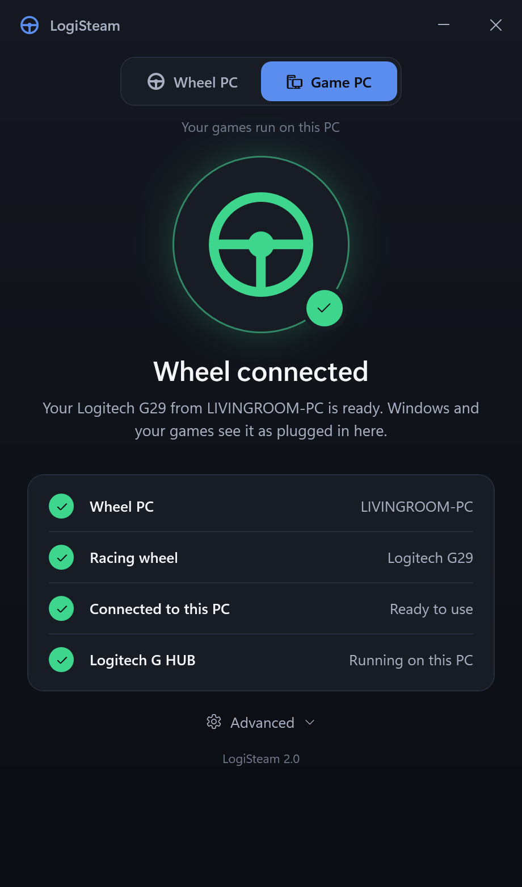
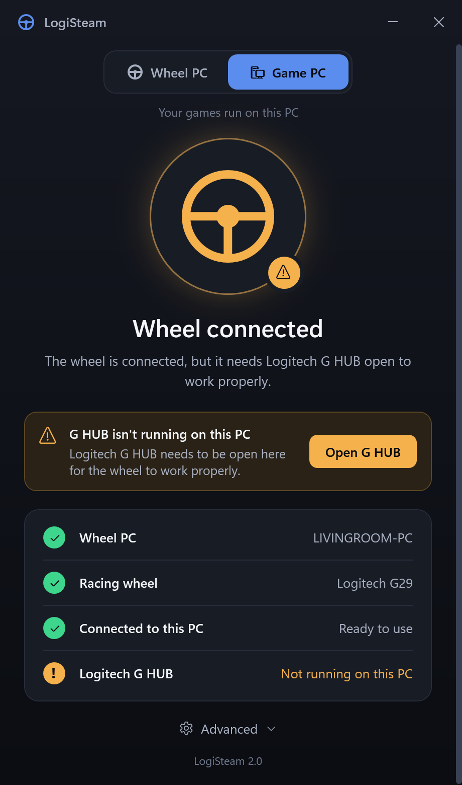
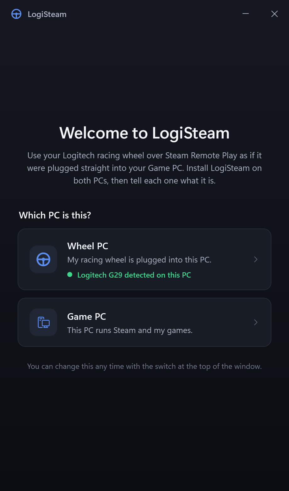
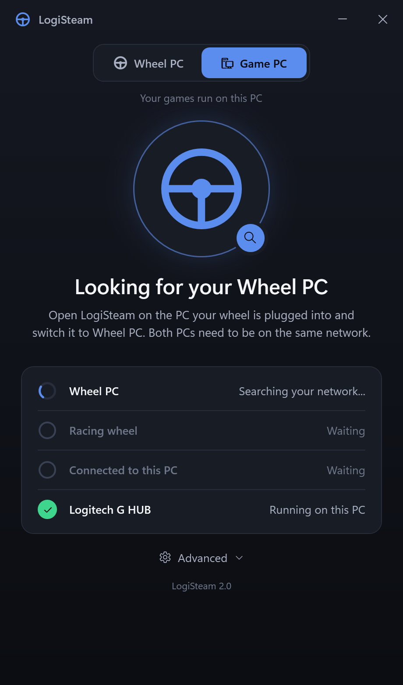

<h1 align="center">LogiSteam</h1>

<p align="center">
  <b>Use your Logitech racing wheel over Steam Remote Play, as if it were plugged straight into your gaming PC.</b>
</p>

<p align="center">
  <a href="https://github.com/BigSquidAUS/LogiSteam/releases/latest"></a>
  <a href="https://www.paypal.com/donate/?hosted_button_id=NZJ7CCVL7Y5GS"></a>
  
  <a href="LICENSE"></a>
</p>

<p align="center">
  
  &nbsp;
  
  &nbsp;
  
</p>

Steam Remote Play streams your game beautifully, but it only forwards simple gamepad input. A
racing wheel plugged into the PC you are sitting at shows up on the gaming PC as a basic
controller, or not at all.

LogiSteam fixes that. It tunnels the wheel's real USB connection across your home network, so
the gaming PC sees the actual wheel: full steering resolution, pedals, shifter and every button.

## Features

- **Finds your wheel by itself.** Plug it in and LogiSteam identifies it. There is no device
  list to pick from and nothing to configure.
- **Finds your other PC by itself.** No IP addresses to type.
- **One app for both PCs.** Install the same LogiSteam on each and flip a switch to say which is
  which.
- **Tells you what is happening in plain words**, with a checklist of how far the connection has
  got and a coloured tray icon (blue: working on it, green: connected, amber: needs attention,
  red: broken).
- **Warns you when Logitech G HUB isn't running** on the gaming PC, with a button to open it.
- **Recovers on its own** after sleep, a network blip, or a mode switch on the wheel.

## Download

**[Download the latest LogiSteam-Setup.exe](https://github.com/BigSquidAUS/LogiSteam/releases/latest)**

Windows may show a "Windows protected your PC" notice because the installer is not code-signed.
Choose **More info > Run anyway**.

## Quick start

You need two Windows 10/11 PCs on the same home network (wired is strongly recommended) and
[Logitech G HUB](https://www.logitechg.com/innovation/g-hub.html) on the gaming PC.

1. **Install LogiSteam on both PCs** using the same installer.
2. On the PC your wheel is plugged into, choose **Wheel PC**. Accept the one-time Windows
   permission prompt that lets LogiSteam share the wheel.
3. On the PC that runs Steam and your games, choose **Game PC**, and make sure G HUB is open.
4. Wait for both windows to say **Wheel connected**. The wheel will spin to calibrate itself.
5. Start your Steam Remote Play session and drive.

<p align="center">
  
  &nbsp;
  
</p>

You can close the window at any time. LogiSteam keeps running in the system tray so the wheel
stays connected; click the tray icon to open it again.

## Supported wheels

Identified automatically: **Logitech G29, G920, G923 (Xbox version), G27, G25, Driving Force GT,
Driving Force Pro, Driving Force EX and MOMO Racing**. Other Logitech wheels are recognized by
their product name.

Developed and tested on a **G29**. Reports for other models are very welcome.

If your wheel isn't found, open **Advanced > Choose the wheel manually** and pick it from the
list. Any USB device can be shared this way.

## Troubleshooting

| What you see | What to try |
|---|---|
| "Looking for your Wheel PC" / "Looking for your Game PC" never changes | Check LogiSteam is running on the other PC and set to the opposite role, and that both PCs are on the same network. |
| "One-time permission needed" | Click **Allow** and choose Yes on the Windows prompt. |
| Amber "G HUB isn't running" warning | Open Logitech G HUB on the PC named in the warning. |
| The wheel stops responding mid-session | On the Game PC: **Advanced > Reconnect the wheel**. |
| The wheel misbehaves even though everything is green | Turn on **Advanced > G HUB on the Wheel PC: required** on both PCs, and open G HUB on the Wheel PC too. |
| Still stuck | **Advanced > Diagnostics** shows connection details you can copy into an [issue](https://github.com/BigSquidAUS/LogiSteam/issues). |

## Good to know

- **Use a wired network.** USB traffic is timing-sensitive and Wi-Fi jitter causes dropouts.
- **Both PCs must be on the same network** (the same subnet). LogiSteam does not work over the
  internet.
- **Force feedback** travels over the same tunnel as everything else, but it is the most
  timing-sensitive part and has only been tried on one setup. Please report how it works for you.
- **Use it on a network you trust.** The Game PC connects to whatever wheel a LogiSteam Wheel PC
  on your network offers; there is no pairing step. LogiSteam also answers read-only status
  queries from your local network for troubleshooting.

## Support the project

LogiSteam is free and open source. If it got your wheel working, you can say thanks here:

<a href="https://www.paypal.com/donate/?hosted_button_id=NZJ7CCVL7Y5GS"></a>

## How it works

LogiSteam is a friendly front end for two excellent open-source USB/IP projects, which do the
heavy lifting:

| This PC is the... | Built on | What LogiSteam does |
|---|---|---|
| Wheel PC | [usbipd-win](https://github.com/dorssel/usbipd-win) | Identifies the wheel and shares it over the LAN |
| Game PC | [usbip-win2](https://github.com/vadimgrn/usbip-win2) | Attaches the shared wheel as if it were plugged in locally |

The installer sets up both for you. See [`docs/ARCHITECTURE.md`](docs/ARCHITECTURE.md) for the
design and [`docs/SETUP.md`](docs/SETUP.md) for detailed setup and diagnostics.

## Building from source

Requires the [.NET 8 SDK](https://dotnet.microsoft.com/download) on Windows.

```
dotnet build LogiSteam.sln
dotnet test LogiSteam.sln
```

To build the installer (requires [Inno Setup 6](https://jrsoftware.org/isinfo.php)):

```
dotnet publish src\LogiSteam.App -c Release -r win-x64 --self-contained true -o publish\LogiSteam
"C:\Program Files (x86)\Inno Setup 6\ISCC.exe" installer\LogiSteam.Setup\LogiSteam.iss
```

```
src/LogiSteam.Common/          Wheel identification, LAN discovery, USB/IP tool wrappers,
                               G HUB detection, and the "what should the window say" logic
src/LogiSteam.App/             The app: WPF window, tray icon, and the Wheel PC / Game PC roles
tests/LogiSteam.Common.Tests/  Unit tests
installer/                     Inno Setup script and the bundled prerequisite installers
```

## License and credits

LogiSteam is released under the [MIT License](LICENSE).

It bundles, unmodified, [usbipd-win](https://github.com/dorssel/usbipd-win) (GPL-3.0) and
[usbip-win2](https://github.com/vadimgrn/usbip-win2) (BSD-2-Clause), and uses
[HidSharp](https://www.zer7.com/software/hidsharp) (Apache-2.0). See
[`THIRD-PARTY-NOTICES.md`](THIRD-PARTY-NOTICES.md) for details and full license texts.

LogiSteam is an independent project. It is not affiliated with, endorsed by, or sponsored by
Logitech or Valve. Logitech, G HUB, Steam and Steam Remote Play are trademarks of their
respective owners.
